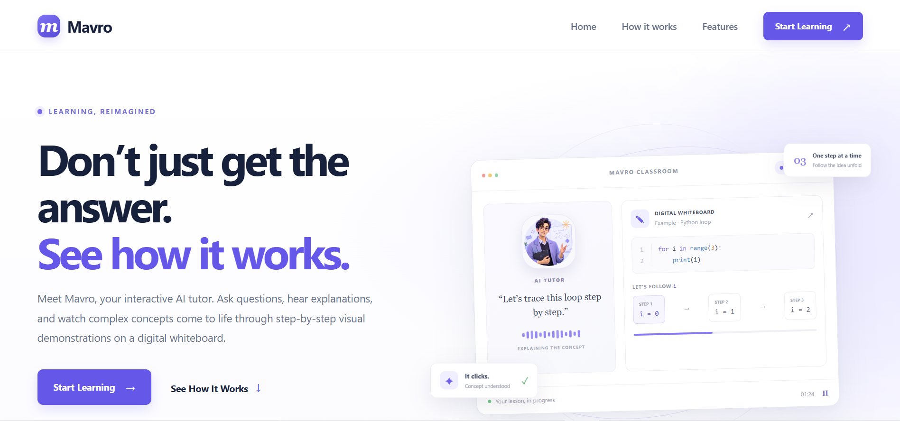
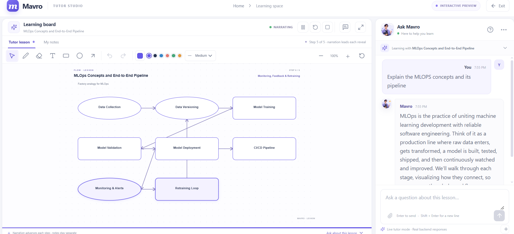
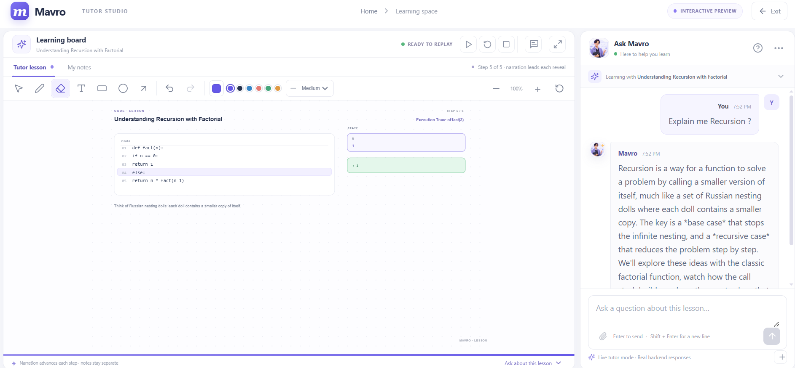

<p align="center">
  
  
  
  
  
</p>

# Mavro

**An interactive AI tutor that helps learners understand concepts through conversation, visual explanations, and narrated lessons.**

Mavro turns a student's question into a structured lesson. The React application presents the tutor's response in chat and can translate supported actions into a deterministic whiteboard scene. Lesson steps can be narrated progressively while their visual elements are revealed. Students can also use a separate whiteboard layer for their own notes and drawings.

The project includes a responsive marketing homepage, a tutor studio, a FastAPI backend, Groq model integration, in-memory conversation context, a structured teaching-response schema, and configurable narration providers.

## Screenshots

### Homepage



### Tutor studio: MLOps lesson



### Tutor studio: recursion lesson



## Product capabilities

- **Question-based tutoring:** Students submit questions in the tutor chat. The backend sends the question, recent conversation history, and lesson context to Groq.
- **Structured lessons:** Responses include a lesson title, written answer, spoken explanation, ordered steps, follow-up question, and board summary.
- **Dynamic teaching board:** A deterministic layout engine validates lesson actions and maps them into code panels, concepts, diagrams, shapes, arrows, equations, tables, graphs, variable state, and output panels. It packs content into safe regions, separates colliding elements, and auto-fits oversized scenes.
- **Progressive lesson playback:** The playback hook coordinates narration with step-by-step visual reveals. Students can pause, resume, stop, replay, and restart a lesson.
- **Student-created notes:** Freehand marks, text, shapes, arrows, selection, erasing, colors, zoom, undo/redo, and clear confirmation are separate from AI lesson scenes.
- **Narration options:** The frontend can request server-generated speech from the voice API and falls back to the browser Speech Synthesis API when server TTS is unavailable.
- **Responsive interface:** The landing page and tutor studio adapt to desktop, tablet, and mobile viewport sizes.
- **No account required:** The current MVP does not implement authentication or user accounts.

## How the application is organized

```text
Mavro/
├── main.py                     # FastAPI app, CORS, health check, router registration
├── requirements.txt            # Python backend dependencies
├── .env.example                # Backend configuration template; no real credentials
├── routes/
│   ├── tutor.py                # Tutor chat, in-memory conversations, reset endpoint
│   └── voice.py                # Speech status and synthesis endpoints
├── schemas/
│   └── tutor.py                # Validated request, response, step, and action models
├── services/
│   ├── groq_service.py         # Groq request, structured response parsing, error handling
│   ├── tutor_prompt.py         # Mavro tutoring instructions and action contract
│   ├── whiteboard_service.py   # Safe unavailable-provider response
│   └── tts_service.py          # Configurable server-side text-to-speech providers
├── tests/
│   └── test_tutor_api.py       # API health, chat, validation, and schema regression tests
├── images/                     # Project screenshots used in this README
└── frontend/
    ├── .env.example            # Public frontend API URL template
    ├── package.json            # React, Vite, lint, and build scripts
    └── src/
        ├── App.jsx             # Route selection for homepage and /tutor
        ├── TutorDashboard.jsx  # Chat, lesson, conversation, and playback state
        ├── components/         # Homepage, chat, avatar, and whiteboard components
        ├── hooks/              # Whiteboard state and lesson playback orchestration
        └── services/           # API client, lesson layout, whiteboard model, voice client
```

The frontend is written in JavaScript with JSX. It is not a TypeScript project at this time. Pydantic schemas validate the backend's structured API data.

## Technology

### Frontend

- React 19
- Vite 8
- Lucide React icons
- SVG-based teaching scene renderer
- Browser audio playback and Speech Synthesis fallback

### Backend

- Python
- FastAPI and Uvicorn
- Pydantic request and response validation
- Groq Python SDK for text generation
- `python-dotenv` for local environment configuration
- `httpx` for server-side speech-provider requests

## Getting started

### Prerequisites

- Python 3.11 or newer is recommended.
- Node.js 20 or newer and npm.
- A Groq API key for live model responses.
- Optional speech-provider credentials for server-generated narration. Without a configured server TTS provider, the browser speech fallback may be used.

### 1. Configure the backend

From the repository root, create a local `.env` file from the example:

```powershell
Copy-Item .env.example .env
```

Set `GROQ_API_KEY` to a valid key and review the model selection. The checked-in example currently uses `openai/gpt-oss-120b`; use a model available to your Groq account.

The `.env.example` also documents optional server-side speech configuration. For development without server TTS credentials, set `TTS_PROVIDER=none` or leave it at `auto` to use any configured provider and otherwise fall back in the frontend.

Never put Groq or TTS provider credentials in a `VITE_` variable. Vite variables are delivered to the browser. The root `.env` is excluded from Git.

Install Python dependencies:

```powershell
python -m venv .venv
.\.venv\Scripts\Activate.ps1
python -m pip install -r requirements.txt
```

On macOS or Linux, activate the environment with:

```bash
source .venv/bin/activate
```

### 2. Configure the frontend

From the `frontend` directory:

```powershell
Copy-Item .env.example .env
npm install
```

The frontend example points to the local API at `http://localhost:8000`. This value is public and does not contain a secret.

### 3. Start the backend and frontend

Start FastAPI from the repository root:

```powershell
uvicorn main:app --reload
```

Start Vite in a second terminal:

```powershell
cd frontend
npm run dev
```

Open the Vite URL printed in the terminal. The homepage is `/`; the tutor studio is `/tutor`.

For a production frontend build:

```powershell
cd frontend
npm run build
```

To run the configured frontend lint check:

```powershell
cd frontend
npm run lint
```

## Configuration reference

### Backend (`.env`)

| Variable | Purpose | Example |
| --- | --- | --- |
| `GROQ_API_KEY` | Server-side Groq credential | `your-groq-api-key` |
| `GROQ_MODEL` | Groq chat model | `openai/gpt-oss-120b` |
| `FRONTEND_ORIGIN` | Allowed frontend origin for CORS; comma-separated origins are supported | `http://localhost:5173` |
| `TTS_PROVIDER` | TTS provider selection: `elevenlabs`, `groq`, `openai`, `none`, or `auto` | `auto` |
| `ELEVENLABS_API_KEY` | Optional ElevenLabs speech credential | Optional |
| `GROQ_TTS_API_KEY` | Optional Groq Orpheus speech credential; can use `GROQ_API_KEY` | Optional |
| `OPENAI_TTS_API_KEY` | Optional OpenAI speech credential | Optional |

See [.env.example](.env.example) for the full set of speech voice, model, and cache options. Keep actual credentials in the ignored `.env` file only.

### Frontend (`frontend/.env`)

| Variable | Purpose | Example |
| --- | --- | --- |
| `VITE_API_BASE_URL` | Base URL for the FastAPI backend | `http://localhost:8000` |

## API overview

### Health check

```http
GET /api/health
```

Returns a simple service status object.

### Chat with Mavro

```http
POST /api/tutor/chat
Content-Type: application/json
```

Request fields:

| Field | Type | Required | Description |
| --- | --- | --- | --- |
| `conversation_id` | string | Yes | Frontend-generated in-memory conversation key |
| `message` | string | Yes | Student's current question |
| `board_summary` | string or null | No | Current frontend lesson/board context |

The response follows the Pydantic `TutorResponse` schema and includes `lesson_title`, `mode`, `message`, `spoken_explanation`, `steps`, `follow_up_question`, and `board_summary`. Each step has an ID, title, narration, layout hint, and declarative `whiteboard_actions`.

### Reset conversation

```http
DELETE /api/tutor/chat/{conversation_id}
```

Discards the in-memory history for the given conversation ID.

### Voice

- `GET /api/voice/status` reports whether a server-side TTS provider is available.
- `POST /api/voice/synthesize` accepts narration text and returns audio bytes when a provider is configured.

The conversation ID is only a memory key; it is not an authentication token or authorization boundary.

## Request and lesson flow

1. React creates a conversation ID for a new tutor conversation.
2. The chat service sends the current question, conversation ID, and board summary to FastAPI.
3. The tutor route loads bounded conversation history and the previous structured lesson.
4. The Groq service sends the current prompt and context to the configured Groq model, validates the JSON response against Pydantic models, and normalizes lesson identity for follow-ups.
5. The frontend turns the response into a lesson scene with the deterministic layout engine. AI output provides declarative lesson actions; the frontend does not execute model-provided code or HTML.
6. Lesson playback narrates each step and reveals its board actions progressively. Student drawings and notes remain in a separate whiteboard layer.
7. The frontend uses the current response narration for speech. The narration player prefers server-generated audio when available and can fall back to browser speech synthesis.

## Whiteboard action and layout model

The model describes teaching intent using supported action types such as:

- `show_text`
- `show_code`
- `highlight_code`
- `show_variable`
- `show_output`
- `show_table` (columns and numeric/text rows)
- `show_graph` (numeric points rendered without evaluating an expression)
- `add_shape`
- `add_arrow`
- `update_element`
- `highlight_element`

The frontend layout service converts those actions into a fixed board coordinate system. The model does not control arbitrary HTML, CSS, JavaScript, or SVG markup. It validates table rows, graph points, action targets, and geometry before rendering, then packs each lesson layout into non-overlapping regions with a final auto-fit pass. Layout hints include `auto`, `code`, `flow`, `stack`, `queue`, `tree`, `equation`, and `concept`.

For follow-ups, a stable lesson ID and stable action IDs allow the playback hook to preserve unchanged steps and reveal revised parts. A new lesson replaces the previous AI lesson scene. Student-created drawing elements are managed separately and are not cleared by loading a lesson.

## Testing and quality checks

Backend API regression tests are in `tests/test_tutor_api.py`. Run them from the repository root:

```powershell
python -m pytest tests/test_tutor_api.py -q
```

The backend tests cover the health endpoint, chat and follow-up behavior, empty question validation, rich table/graph action validation, and normalization of flat whiteboard action payloads. Chat tests may use the backend's explicit unavailable-provider response if no Groq key is configured; this validates the application fallback, not live model quality.

`npm run test:layout` runs the frontend layout regression tests. They build representative code, equation, flow, concept, and invalid-data lessons, then assert that no rendered elements overlap, all geometry is finite, and oversized scenes stay inside the board.

Frontend checks are defined in `frontend/package.json`:

```powershell
cd frontend
npm run lint
npm run test:layout
npm run build
```

Live Groq responses and third-party TTS output require configured credentials and network access. A passing API test without a configured Groq key is not proof that live model generation or third-party speech works; verify those integrations separately with valid credentials.

## Privacy, security, and current limitations

- Groq and TTS credentials must remain in the backend `.env`; never commit real secrets or expose them to the frontend.
- CORS is configured from `FRONTEND_ORIGIN` rather than allowing all origins by default.
- Conversation history is held in process memory. It is lost when the API process restarts and is not shared across multiple workers. This is an MVP implementation, not durable storage.
- The app does not currently provide accounts, access control, or persistent lesson history.
- Groq rate limits, model availability, and structured-output reliability depend on the configured Groq account and model. The backend currently returns an explicit tutor-unavailable response if generation or validation fails; it should not be treated as a generated answer.
- Server-generated speech depends on provider configuration, terms, quotas, and network access. Browser narration is the fallback where supported.
- The current frontend codebase uses JavaScript/JSX. Shared API data is validated on the backend with Pydantic; the frontend performs runtime normalization for lesson responses.

## Project screenshots

Screenshots are stored in the repository's `images/` directory and embedded above:

- `images/1.PNG` — homepage
- `images/2.PNG` — tutor studio with an MLOps pipeline lesson
- `images/3.PNG` — tutor studio with a recursion lesson
